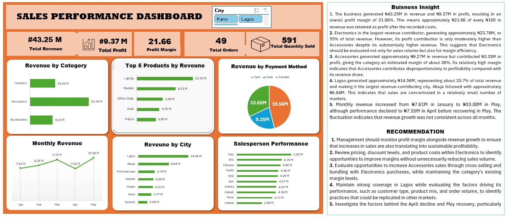

# Sales Performance Dashboard

## Project Overview

This project presents an interactive **Sales Performance Dashboard** designed to analyse business sales performance across different product categories, cities, payment methods, and salespersons.

The dashboard provides a visual summary of key business metrics, helping management understand revenue generation, profitability, product performance, and sales trends. It also highlights areas that require improvement and provides recommendations to support better business decisions.

## Dashboard Preview

## Key Performance Indicators (KPIs)

The dashboard presents the following business performance metrics:

- **Total Revenue:** ₦43.25 Million
- **Total Profit:** ₦9.37 Million
- **Profit Margin:** 21.66%
- **Total Orders:** 49
- **Total Quantity Sold:** 591 units

## Dashboard Features

The dashboard contains six major visualisations:

1. **Revenue by Category:** Compares revenue generated from Furniture, Electronics, and Accessories.
2. **Top 5 Products by Revenue:** Identifies the five products contributing the highest revenue.
3. **Revenue by Payment Method:** Shows the distribution of revenue across Card, Cash, and Transfer payments.
4. **Monthly Revenue:** Tracks monthly sales performance from January to May.
5. **Revenue by City:** Compares revenue generated across different cities.
6. **Salesperson Performance:** Evaluates individual sales contributions and identifies top-performing salespersons.

## Key Business Insights

The analysis revealed the following:

- The business generated ₦43.25 million in revenue and ₦9.37 million in profit, with an overall profit margin of 21.66%.
- Electronics was the highest revenue-generating category, contributing approximately ₦23.78 million.
- Accessories generated approximately ₦9.27 million in revenue but contributed about ₦3.33 million in profit, representing a strong profit margin.
- Lagos recorded the highest revenue of approximately ₦14.56 million, followed by Abuja with ₦8.84 million.
- May recorded the highest monthly revenue of ₦10.08 million, while April experienced a decline to ₦7.55 million.
- Laptop was the highest revenue-generating product, contributing approximately ₦11.72 million.

## Recommendations

Based on the analysis, the following recommendations were identified:

1. Management should monitor profit margins alongside revenue growth to ensure that increased sales translate into sustainable profitability.
2. Review pricing, discount levels, and product costs within Electronics to improve profit margins.
3. Explore cross-selling and product bundling opportunities to increase Accessories sales.
4. Maintain strong sales coverage in Lagos while identifying strategies to improve performance in other cities.
5. Investigate the factors responsible for the decline in April revenue and identify strategies that can sustain monthly sales growth.

## Tools and Skills Demonstrated

- Microsoft Excel
- Data Analysis
- Data Visualisation
- Dashboard Design
- Business Intelligence
- Sales Performance Analysis
- Data Interpretation
- Business Reporting

## Conclusion

This project demonstrates how sales data can be transformed into meaningful business insights through data visualisation and dashboard reporting. The dashboard provides a clear overview of business performance and helps identify trends, strengths, and areas that require attention.

It also demonstrates the importance of using data-driven insights to support strategic business decisions and improve overall business performance.

---

**Project Category:** Data Analysis and Visualisation

**Author:** Olamide Olowe
